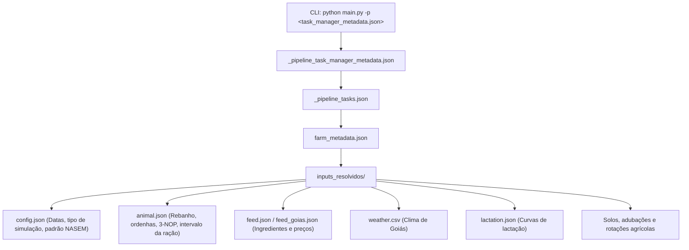

# Guia de Operação e Simulação: RuFaS-dev & Fazenda Campo Dourado

Este documento serve como a **referência técnica e operacional oficial** para o fluxo de simulação biofísica e otimização de dietas do projeto. Ele estabelece a relação entre o simulador oficial (**`RuFaS-dev`**) e o modelo de fazenda sintética de Goiás (**`Fazenda Campo Dourado`**).

---

## 1. Visão Geral e Papel de Cada Componente

```
d:\projetos\ia\IFG\otimizacao-dietas-ruminantes\
│
├── RuFaS-dev/                     ◄── [SIMULADOR OFICIAL]
│   ├── .venv/                     (Ambiente virtual Python 3.13 com dependências)
│   ├── RUFAS/                     (Código-fonte dos módulos biofísicos)
│   ├── main.py                    (Ponto de entrada do simulador)
│   ├── output/                    (Diretório onde CSVs e logs são gravados)
│   └── GO_campo_dourado/          ◄── (Pasta do cenário copiada para cá)
│
├── Fazenda Campo Dourado/         ◄── [TEMPLATE DO CASO BASE GOIÁS]
│   └── GO_campo_dourado/          (Cenário representativo conservador com 100 vacas)
│       ├── _pipeline_task_manager_metadata.json
│       ├── _pipeline_tasks.json
│       ├── farm_metadata.json
│       ├── parametrizacao.json / .md
│       └── inputs_resolvidos/     (Todos os parâmetros de entrada)
│
└── docs/                          ◄── [DOCUMENTAÇÃO TÉCNICA E MATERIAIS DE AULA]
```

* **`RuFaS-dev`**: Núcleo computacional do simulador Ruminant Farm Systems (versão de desenvolvimento). É nele que as simulações devem ser disparadas via terminal.
* **`Fazenda Campo Dourado`**: Caso base pré-configurado para a realidade de Goiás (rebanho de 100 vacas, clima de GO, dieta formulada pelo NASEM, mitigador de metano 3-NOP, etc.). É o conjunto de arquivos que alteramos para criar novos experimentos.

---

## 2. A Hierarquia de Execução e Arquivos de Configuração

O RuFaS utiliza um encadeamento declarativo estrito em cascata:



### Regra de Ouro dos Caminhos Relativos
O RuFaS sempre resolve os caminhos a partir do **diretório de trabalho onde o comando `main.py` é invocado** (isto é, a raiz do `RuFaS-dev`).
Portanto, as referências dentro de `farm_metadata.json` esperam encontrar os arquivos sob:
`GO_campo_dourado/inputs_resolvidos/<nome_do_arquivo>`

---

## 3. Guia de Arquivos em `inputs_resolvidos/` (Onde Fazer Alterações)

Quando for formular novas dietas ou testar cenários, as edições devem ser feitas nos arquivos descritos abaixo:

| Arquivo | Parâmetros Chave | Objetivo da Alteração |
|---|---|---|
| **`config.json`** | `"start_date": "2015:1"`, `"end_date": "2019:365"`, `"nutrient_standard": "NASEM"` | Alterar o intervalo de datas (para testes rápidos, usar ex.: 30 ou 90 dias em vez de 5 anos). |
| **`animal.json`** | `cow_num` (100), `milking_cow_fraction` (0.8356), `cow_times_milked_per_day` (3), `formulation_interval` (45 dias), `3-NOP_additive_amount` (90) | Ajustar características do rebanho, frequência de ordenhas e periodicidade com que a dieta é recalculada. |
| **`feed.json` / `feed_goias.json`** | Inclusões mínimas e máximas de alimentos, custos de aquisição por kg de Matéria Seca (MS). | Testar novos ingredientes (ex.: bagaço de cana, casca de soja, caroço de algodão, farelo de soja, silagem de milho). |
| **`NASEM_Comp.csv`** | Matriz de composição bromatológica (PB, FDN, FDA, NDT, EL_L, Ca, P, aminoácidos). | Calibrar teores nutricionais caso haja análises bromatológicas específicas de Goiás. |
| **`lactation.json`** | Coeficientes de Wood ($a, b, c$) para primíparas, secundíparas e multíparas. | Alterar o pico e a persistência da curva de lactação do lote. |
| **`weather.csv`** | Séries meteorológicas diárias de Goiás (temperatura, umidade, vento, chuva, radiação solar). | Avaliar estresse térmico (THI) em períodos secos vs. chuvosos. |

---

## 4. Passo a Passo Operacional para Execução

### Passo 1: Posicionar o cenário dentro do `RuFaS-dev`
Copie a pasta `GO_campo_dourado` (ou uma cópia sua renomeada, ex.: `GO_campo_dourado_otimizado`) para dentro da raiz de `RuFaS-dev`:

```powershell
# Exemplo no PowerShell (a partir da raiz do repositório)
Copy-Item -Recurse -Path ".\Fazenda Campo Dourado\GO_campo_dourado" -Destination ".\RuFaS-dev\GO_campo_dourado"
```

### Passo 2: Fazer os ajustes desejados
Edite os arquivos em `RuFaS-dev\GO_campo_dourado\inputs_resolvidos\` conforme a hipótese zootécnica ou econômica a ser testada.

> **Dica para Testes Rápidos de Validação:**
> No arquivo `config.json`, reduza o período para não precisar aguardar os 5 anos completos:
> ```json
> {
>   "start_date": "2015:1",
>   "end_date": "2015:60",
>   "set_seed": true,
>   "simulation_type": "full_farm",
>   "nutrient_standard": "NASEM"
> }
> ```

### Passo 3: Executar a simulação no terminal
Abra o terminal na pasta `RuFaS-dev` e execute utilizando o Python do ambiente virtual:

```powershell
# Entrar no RuFaS-dev
cd "d:\projetos\ia\IFG\otimizacao-dietas-ruminantes\RuFaS-dev"

# Executar com o Python do .venv:
.\.venv\Scripts\python.exe main.py -p GO_campo_dourado\_pipeline_task_manager_metadata.json

# Ou usando uv:
uv run python main.py -p GO_campo_dourado\_pipeline_task_manager_metadata.json
```

---

## 5. Verificação de Sucesso e Resultados

### Terminal
Ao terminar a simulação, deve ser exibida a mensagem:
```text
Finished task: 1/1 (GO_campo_dourado) with 0 error(s), ... warning(s), and ... log(s).
```

### Arquivos de Saída
Os resultados consolidados serão gravados em:
* **Tabelas de Variáveis Simadas (CSV):**
  `RuFaS-dev\output\CSVs\GO_campo_dourado_saved_variables_csv_all_variables.txt_<TIMESTAMP>.csv`
* **Logs da Execução:**
  `RuFaS-dev\output\logs\`

### Principais Métricas a Analisar no CSV
1. **Produção de Leite:** Produção individual e total diária do lote (kg/dia).
2. **Consumo de Matéria Seca (CMS):** Total de alimento consumido por vaca.
3. **Custo Diário da Ração e IOFC:** Margem sobre o custo de alimentação (*Income Over Feed Cost*).
4. **Emissões Entéricas:** Metano entérico gerado ($g\text{ CH}_4/\text{dia}$ e $g\text{ CH}_4/\text{kg leite}$).
5. **Eficiência de Nitrogênio:** Excreção de nitrogênio na urina e fezes vs. Nitrogênio no Leite.
