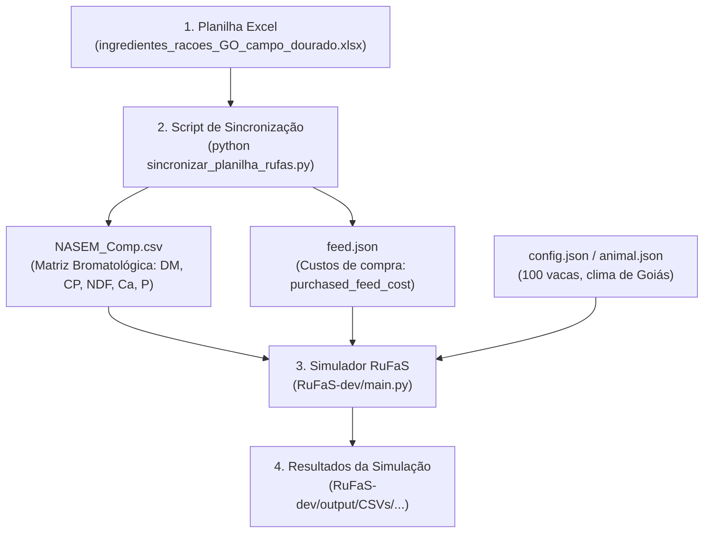

# Guia Passo a Passo: Simulação no RuFaS a partir da Planilha de Ingredientes

Este documento é o guia operacional definitivo para atualizar a composição bromatológica e os custos dos alimentos na planilha **`ingredientes_racoes_GO_campo_dourado.xlsx`**, propagar essas informações para os módulos do **RuFaS (Ruminant Farm Systems)** e executar a simulação biofísica do rebanho da **Fazenda Campo Dourado**.

---

## 1. Visão Geral da Arquitetura

O RuFaS consome dados em formato JSON e CSV estruturados sob o padrão **NASEM (2021)**. A integração entre a planilha e o simulador ocorre por meio de um script automatizado de sincronização:



---

## 2. Pré-requisitos

1. **Terminal aberto na raiz do repositório:**
   ```powershell
   cd "d:\projetos\ia\IFG\otimizacao-dietas-ruminantes"
   ```
2. **Ambiente Python do RuFaS configurado:**  
   O simulador possui um ambiente virtual Python em:
   `d:\projetos\ia\IFG\otimizacao-dietas-ruminantes\RuFaS-dev\.venv`

---

## 3. Passo a Passo Completo

### Passo 1: Ajustar a Planilha Excel (Se Desejado)

Abra a planilha [ingredientes_racoes_GO_campo_dourado.xlsx](file:///d:/projetos/ia/IFG/otimizacao-dietas-ruminantes/Fazenda%20Campo%20Dourado/ingredientes_racoes_GO_campo_dourado.xlsx) e ajuste conforme seu experimento:

| Coluna | Parâmetro | O que representa |
|---|---|---|
| **Col D (`DM (%MS)`)** | Matéria Seca | Teor de MS do alimento (ex.: 35.36% para silagem, 86.91% para milho). |
| **Col E (`CP (%)`)** | Proteína Bruta | Teor de PB expresso em porcentagem da MS. |
| **Col F (`NDF (%)`)** | Fibra em Detergente Neutro | Teor de FDN total da forragem ou concentrado. |
| **Col G (`Ca (%)`)** | Cálcio | Teor de cálcio total (% da MS). |
| **Col H (`P (%)`)** | Fósforo | Teor de fósforo total (% da MS). |
| **Col I (`custo`)** | `purchased_feed_cost` | Preço de aquisição por kg de Matéria Seca (R$/kg MS). |

> [!NOTE]
> Salve e feche a planilha no Excel antes de executar a sincronização para evitar bloqueios de arquivo no Windows.

---

### Passo 2: Executar a Sincronização Automática

Para injetar as alterações da planilha nos arquivos do RuFaS, execute o script [sincronizar_planilha_rufas.py](file:///d:/projetos/ia/IFG/otimizacao-dietas-ruminantes/sincronizar_planilha_rufas.py):

```powershell
# A partir da raiz do repositório:
& "RuFaS-dev\.venv\Scripts\python.exe" sincronizar_planilha_rufas.py
```

#### O que este script faz automaticamente:
1. **Lê o Excel:** Extrai os teores bromatológicos e preços dos 12 alimentos.
2. **Atualiza [NASEM_Comp.csv](file:///d:/projetos/ia/IFG/otimizacao-dietas-ruminantes/Fazenda%20Campo%20Dourado/GO_campo_dourado/inputs_resolvidos/NASEM_Comp.csv):** Injeta os valores nas colunas `DM`, `CP`, `NDF`, `calcium` e `phosphorus`.
3. **Atualiza [feed.json](file:///d:/projetos/ia/IFG/otimizacao-dietas-ruminantes/Fazenda%20Campo%20Dourado/GO_campo_dourado/inputs_resolvidos/feed.json):** Altera o campo `purchased_feed_cost` de cada ingrediente.
4. **Propaga para o Simulador:** Copia os arquivos gerados diretamente para `RuFaS-dev/GO_campo_dourado/inputs_resolvidos/`.

Ao final, deve ser exibida a mensagem:
```text
======================================================================
SINCRONIZAÇÃO CONCLUÍDA COM SUCESSO! O RUFAS ESTÁ PRONTO PARA SIMULAR.
======================================================================
```

---

### Passo 3: (Opcional) Ajustar a Dieta ou o Tempo da Simulação

#### A) Ajustar o Período para Teste Rápido (Recomendado)
A simulação padrão de 5 anos (2015 a 2019) consome vários minutos de CPU. Para validar alterações em menos de 1 minuto, edite o arquivo [config.json](file:///d:/projetos/ia/IFG/otimizacao-dietas-ruminantes/RuFaS-dev/GO_campo_dourado/inputs_resolvidos/config.json):

```json
{
  "start_date": "2015:1",
  "end_date": "2015:60",
  "set_seed": true,
  "simulation_type": "full_farm",
  "nutrient_standard": "NASEM",
  "FIPS_county_code": 55025,
  "include_detailed_values": false
}
```
*(Quando quiser rodar o período completo, retorne `"end_date": "2019:365"`)*.

#### B) Ajustar as Proporções dos Alimentos na Ração
Caso queira testar uma formulação específica para as vacas em lactação, edite o bloco `"rations"` em [feed.json](file:///d:/projetos/ia/IFG/otimizacao-dietas-ruminantes/RuFaS-dev/GO_campo_dourado/inputs_resolvidos/feed.json):

```json
{
  "animal_combination": "lac_cow",
  "intake_option": "predict_DMI",
  "intake_value": null,
  "feeds": [
    { "feed_type": 51,  "ration_percentage": 30 },
    { "feed_type": 110, "ration_percentage": 18 },
    { "feed_type": 44,  "ration_percentage": 24 },
    { "feed_type": 167, "ration_percentage": 16 },
    { "feed_type": 58,  "ration_percentage": 9  },
    { "feed_type": 301, "ration_percentage": 3  }
  ]
}
```
> [!IMPORTANT]
> A soma dos `ration_percentage` de cada lote deve totalizar **100**.

---

### Passo 4: Disparar a Simulação no Terminal

Entre na pasta do simulador oficial (`RuFaS-dev`) e execute o ponto de entrada `main.py` apontando para o metadata da Fazenda Campo Dourado:

```powershell
# 1. Navegar até a raiz do simulador
cd "d:\projetos\ia\IFG\otimizacao-dietas-ruminantes\RuFaS-dev"

# 2. Executar a simulação com o Python do ambiente virtual:
.\.venv\Scripts\python.exe main.py -p GO_campo_dourado\_pipeline_task_manager_metadata.json
```

*(Se estiver usando Linux ou WSL, utilize: `venv/bin/python main.py -p GO_campo_dourado/_pipeline_task_manager_metadata.json`)*.

---

### Passo 5: Mensagem de Sucesso

Ao concluir o cálculo de todos os dias simulados, o terminal apresentará a mensagem:

```text
Finished task: 1/1 (GO_campo_dourado) with 0 error(s), X warning(s), and Y log(s).
```

---

### Passo 6: Onde Encontrar e Como Analisar os Resultados

Todos os resultados biofísicos e econômicos diários são consolidados na pasta de saída:

```
RuFaS-dev/output/CSVs/GO_campo_dourado_saved_variables_csv_all_variables.txt_<TIMESTAMP>.csv
```

#### Principais Colunas para Avaliação Zootécnica e Econômica:

| Variável no CSV de Saída | O que representa | Unidade |
|---|---|---|
| `report_daily_milk_production_per_cow` | Produção média de leite por vaca | kg/vaca/dia |
| `report_daily_intake_per_cow` (ou DMI) | Consumo de Matéria Seca total | kg MS/vaca/dia |
| `report_daily_feed_cost_per_cow` | Custo alimentar diário por vaca | US$ ou R$/vaca/dia |
| `report_daily_IOFC` | Margem sobre o custo alimentar (*Income Over Feed Cost*) | R$/vaca/dia |
| `enteric_methane_emissions` | Metano entérico emitido pelo lote | g CH₄/dia |
| `nitrogen_use_efficiency` | Eficiência de conversão do nitrogênio da dieta em leite | % |

---

## 4. Diagnóstico de Problemas Comuns (Troubleshooting)

1. **Erro `FileNotFoundError` ao iniciar a simulação:**
   * **Causa:** O comando não foi executado de dentro da pasta `RuFaS-dev`.
   * **Solução:** O RuFaS resolve todos os caminhos relativos a partir do diretório de onde o comando é invocado. Certifique-se de executar `cd RuFaS-dev` antes de rodar `main.py`.

2. **Erro `Sum of ration percentages must equal 100`:**
   * **Causa:** Os percentuais dos alimentos no arquivo `feed.json` não somam 100%.
   * **Solução:** Revise o array `"feeds"` dentro do lote correspondente em `feed.json` e garanta que $\sum \text{ration\_percentage} = 100$.

3. **Arquivo Excel bloqueado (`PermissionError`):**
   * **Causa:** A planilha está aberta no Microsoft Excel enquanto o script `sincronizar_planilha_rufas.py` tenta lê-la.
   * **Solução:** Salve e feche o Excel antes de rodar o sincronizador.
